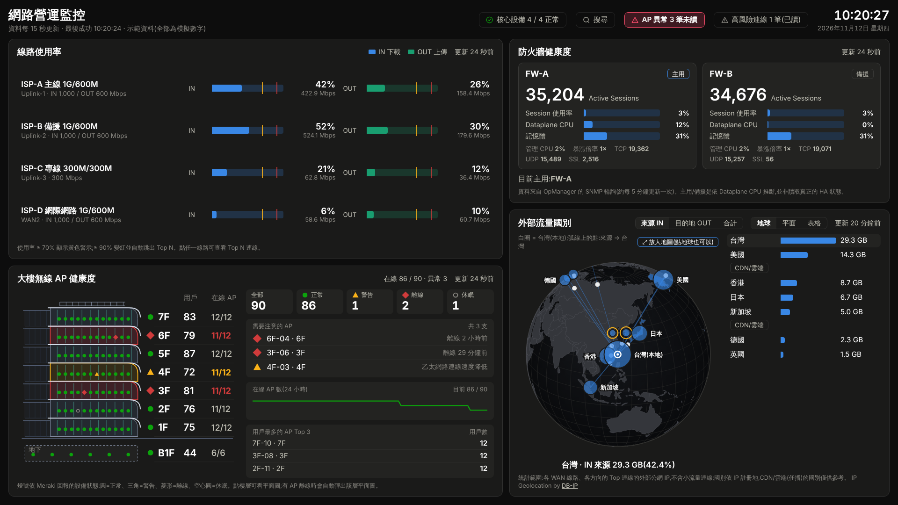
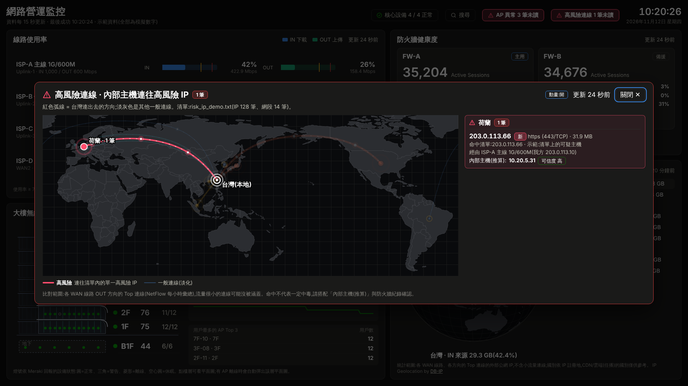
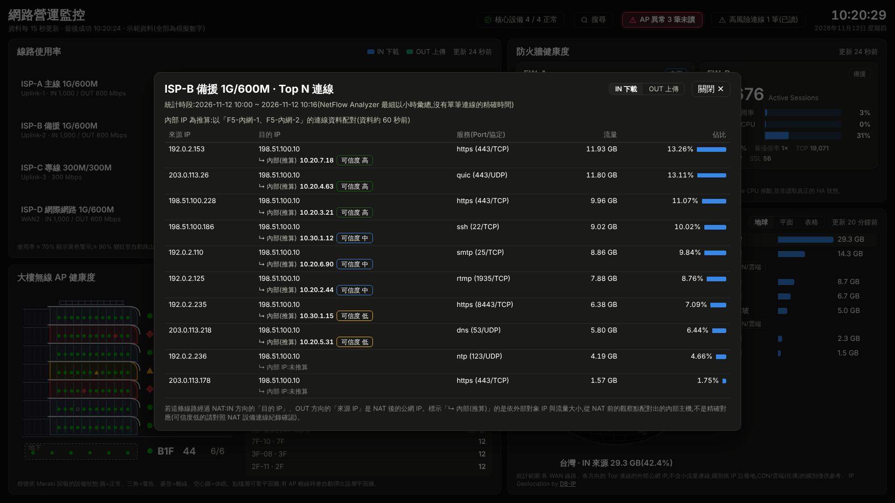
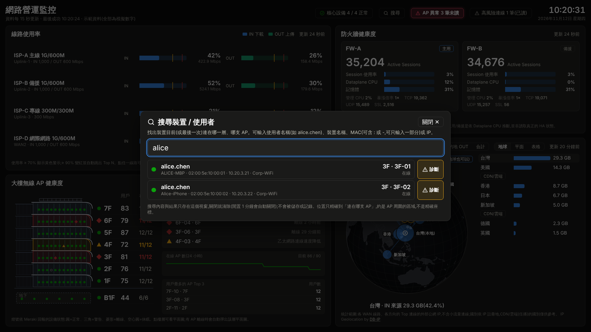
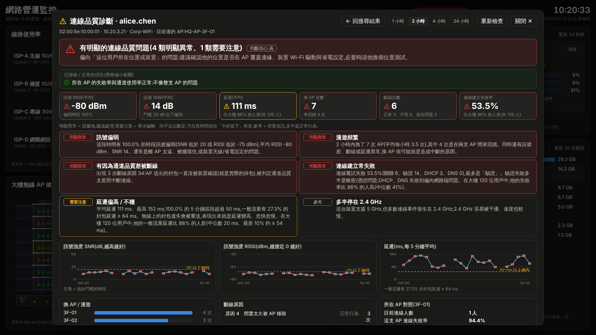
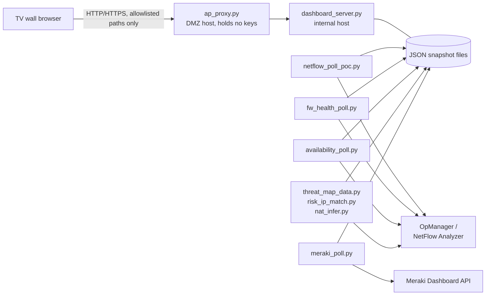

# NOC Wallboard — Network Operations Dashboard

**English** | [繁體中文](README.zh-TW.md)

A TV-wall dashboard for a network operations team. It shows WAN link utilization, firewall HA health, core device availability, traffic by country, and Wi-Fi access point health on one screen, and lets an engineer drill down from "this link is saturated" to "which internal host is causing it" in two clicks.

It runs on plain Python and a single HTML file. There is no framework, no database and no build step.

> **All data in the demo is synthetic.** Device names, people, MAC addresses and IP addresses are invented. IPs use documentation ranges (RFC 5737) or private ranges.



## Try it

**Live demo (no install):** `https://s9828027-hue.github.io/noc-dashboard/`
The page is static. Simulated data is generated in the browser, changes every minute, and one link goes over its threshold every 8 minutes so you can see the alert state.

**Run it locally (Python 3.10+, no packages needed):**

```bash
git clone https://github.com/s9828027-hue/noc-dashboard.git
cd noc-dashboard
python dashboard_server.py --demo
# open http://127.0.0.1:8080/
```

Things to try in the demo:

- Click a WAN link to see its Top N conversations, with the inferred pre-NAT internal host.
- Click a floor in the Wi-Fi panel to open the floor plan with AP positions.
- Click **搜尋** (Search) and type `alice`, `bob`, or `10.20.5` to find which AP a client is on.
- Click **診斷** (Diagnose) on a search result to see the connection quality analysis.

## What it does

| Area | What you see | Data source in production |
|---|---|---|
| WAN link utilization | Download and upload against the contracted bandwidth, with warning and critical thresholds. A saturated link turns red and opens Top N automatically. | ManageEngine NetFlow Analyzer API |
| Top N with NAT inference | Top conversations per link. Because the WAN side only sees post-NAT addresses, the tool matches flows against a pre-NAT observation point and shows the likely internal host with a confidence level. | NetFlow Analyzer API |
| Firewall HA health | Sessions, dataplane CPU, memory, session surge ratio, and which unit is active. A change of active unit is flagged as a failover. | OpManager (SNMP monitors) |
| Core device availability | Ping, response time and packet loss for core switches and firewalls. | OpManager API |
| Traffic by country | Globe, flat map or table of inbound and outbound traffic by country, with CDN and cloud traffic marked as unreliable for geolocation. | NetFlow + offline IP-to-country database |
| High-risk IP matching | Matches outbound conversations against an internal blocklist and shows the inferred internal host. | NetFlow + list files |
| Wi-Fi AP health | Per-floor AP status, floor plans with AP positions, and automatic pop-up of the floor plan when an AP goes offline. | Cisco Meraki Dashboard API (read-only) |
| Client search and diagnosis | Find a user or device by name, MAC or IP. Diagnose signal, roaming, latency, disconnect reasons and connection failures, compared against other clients in the building. | Meraki Dashboard API (read-only) |

| | |
|---|---|
|  |  |
|  |  |

## Architecture



- **Collectors** are small independent scripts. Each one polls one source and writes one JSON snapshot. If one collector fails, the other panels keep working, and the wallboard shows that panel as stale.
- **`dashboard_server.py`** serves the page and merges the snapshots into `/api/summary`. It uses only the Python standard library.
- **`ap_proxy.py`** is an optional forwarder for a split deployment: the host that the TV wall can reach holds no API keys and can only forward an allowlist of read-only paths.
- **`dashboard.html`** is a single self-contained file (vanilla JavaScript, embedded map data), so the wallboard works on a network with no internet access.

## Design decisions

**Security**

- API keys stay on the internal host. They are stored with Windows DPAPI machine-level encryption plus file ACLs, never in source or config files.
- The host exposed to the TV wall network runs only the forwarder and has no credentials.
- Every upstream API call is read-only. Nothing in this repository writes to a network device.
- The server accepts only allowlisted paths and validated parameters, and can restrict clients by source IP.

**Privacy**

- Client search and diagnosis results live only in the browser window's memory. They are cleared when the window closes or after one minute of inactivity.
- Search strings and results are never written to disk, to the URL, or to server logs.

**Operations**

- Staged, reversible rollout. Each feature is optional and falls back to the previous behavior when its data or key is missing.
- Alerts that the team cannot act on are shown as information only. For example, Wi-Fi connection success rate is displayed but does not change the status light, because authentication retries keep it low in normal operation.
- Diagnosis uses fixed, explainable rules and compares a client against the rest of the building, so a finding means "worse than peers", not "above an arbitrary number".

## Extensibility

These pieces were built on the same foundation and run in the original environment. They are **not included** in this repository; the hooks they use are.

- **Direct SNMP measurement.** The NetFlow API's hourly aggregates turned out to disagree with switch counters. A separate read-only poller reads `ifHCInOctets` / `ifHCOutOctets` over SNMP and serves per-link rates as JSON. `netflow_poll_poc.py` has an overlay hook for it (`snmp_source.sample.json`): when the SNMP source is healthy it replaces the link numbers, and when it is stale or unreachable the collector falls back to NetFlow automatically.
- **Capacity-aware WAN path selection.** A dry-run decision engine reads the same snapshots and decides when a link is "full" using hysteresis (N consecutive samples to enter, a minimum hold time and a lower threshold to leave) and fails safe on stale data. It can replay recorded history to test thresholds before anything is enabled. Writing the result to a load balancer is deliberately the last, separately approved stage.
- **Chat alerts.** Because every collector already writes a snapshot and a history file, sending threshold alerts to a chat webhook only needs a small reader with de-duplication.

Adding a new panel follows the same pattern: write a collector that produces one JSON file, register it in `SOURCES` in `dashboard_server.py`, and add a render function in `dashboard.html`.

## Repository layout

| Path | Purpose |
|---|---|
| `dashboard.html` | The wallboard (single file) |
| `dashboard_server.py` | Local data server; `--demo` runs with simulated data |
| `netflow_poll_poc.py`, `fw_health_poll.py`, `availability_poll.py` | Collectors, one per panel |
| `threat_map_data.py`, `risk_ip_match.py`, `nat_infer.py`, `fetch_topn.py` | Country map, blocklist matching, NAT inference, Top N |
| `meraki_poll.py` | Meraki collector, client search and diagnosis |
| `ap_proxy.py` | Optional forwarder for split deployments |
| `noc_service.ps1`, `start_noc.*`, `stop_noc.*` | Windows scheduled-task installer and launchers |
| `opm_discover.py`, `list_nfa_interfaces.py`, `meraki_discover.py`, `meraki_client_probe.py` | Discovery tools used when onboarding a new environment |
| `analyze_baseline.py`, `review_thresholds.py`, `monthly_threshold_review.py` | Threshold tuning from recorded history |
| `demo/` | Simulated data generator, fake Meraki API for testing, static-site builder |
| `docs/` | GitHub Pages demo and screenshots |
| `DEPLOY.zh-TW.txt` | Deployment guide (Traditional Chinese) |

## Using it with real devices

1. `pip install -r requirements.txt`
2. Set `OPM_BASE_URL` to your OpManager / NetFlow Analyzer address and edit the device and link tables at the top of each collector (`LINE_MAP`, `DEVICES`, `FIREWALLS`). The values in this repository are placeholders.
3. Follow `DEPLOY.zh-TW.txt` for key storage, scheduled tasks and firewall rules.

The discovery tools (`opm_discover.py`, `list_nfa_interfaces.py`, `meraki_discover.py`) list what your environment exposes so you can fill in those tables.

## Development notes

- Code comments and UI text are in Traditional Chinese, because the tool was written for a Chinese-speaking operations team.
- `demo/fake_meraki_api.py` is a fake Meraki API. The canned search and diagnosis responses in `demo/canned/` were recorded by running the real `meraki_poll.py` against it, so the demo data has exactly the production format.
- After changing `dashboard.html` or `demo/demo_data.py`, run `python demo/build_static.py` to rebuild `docs/`.

## Credits

Third-party code and data are listed in [THIRD_PARTY_NOTICES.md](THIRD_PARTY_NOTICES.md). Product names (ManageEngine, Cisco Meraki, Palo Alto Networks, F5) belong to their owners; this project is not affiliated with them.
