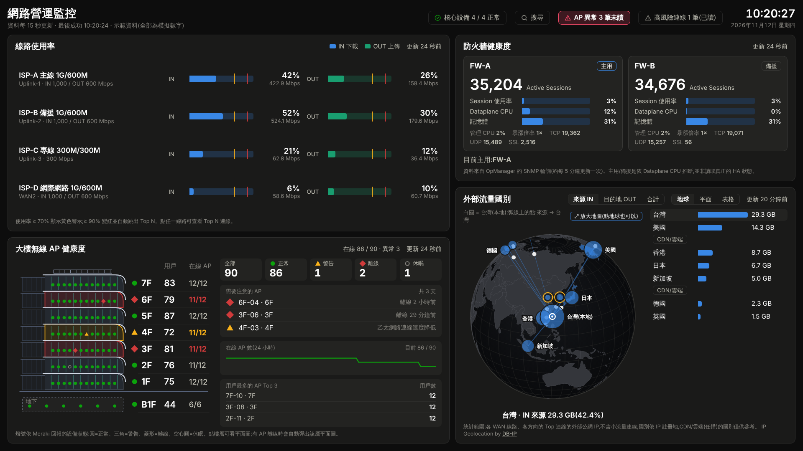
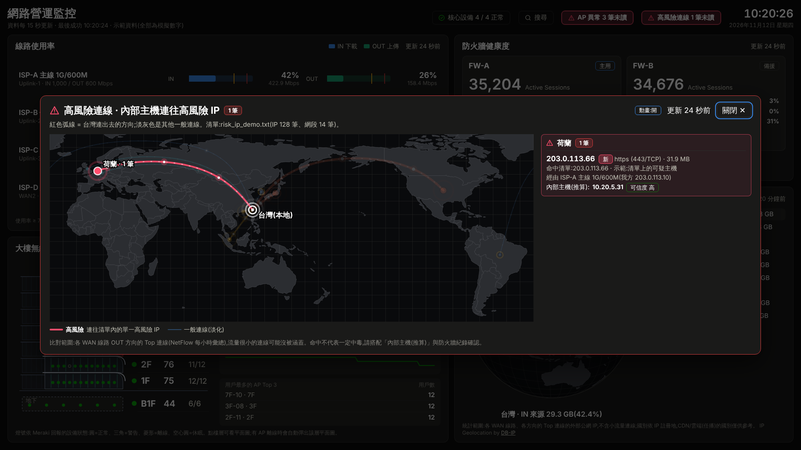
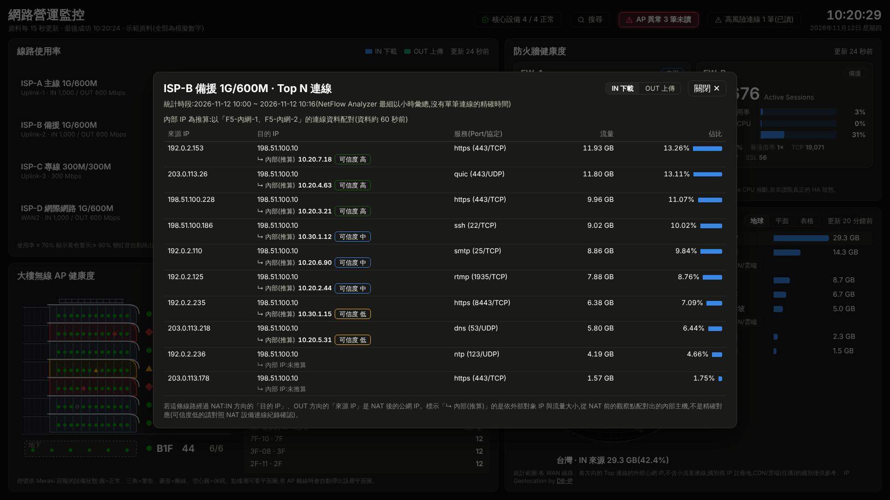
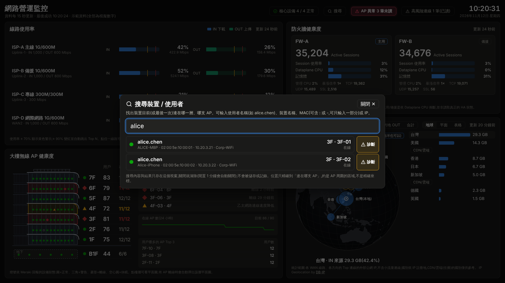
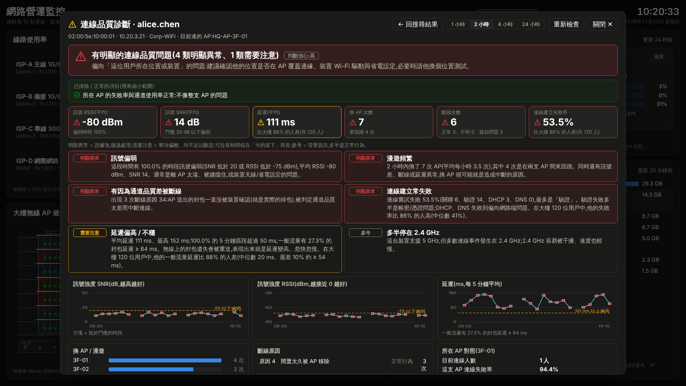
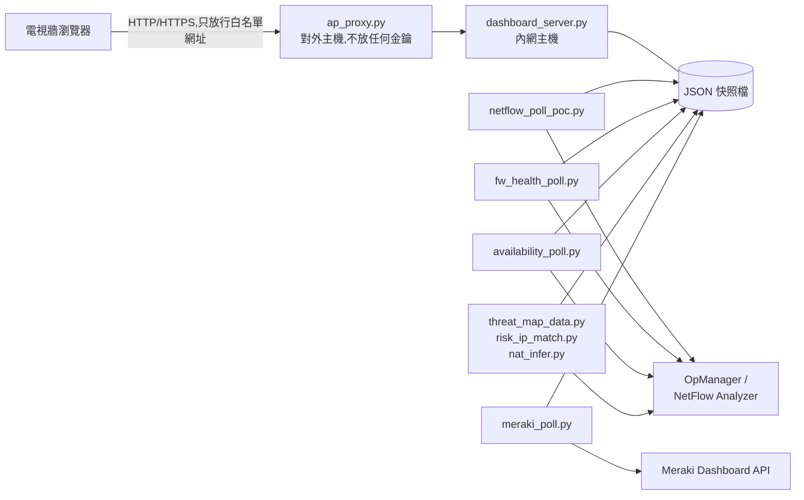

# NOC 大螢幕 — 網路營運監控儀表板

[English](README.md) | **繁體中文**

給網管團隊放在電視牆上的監控畫面。一個畫面同時看到對外線路使用率、防火牆 HA 健康度、核心設備存活、外部流量國別,以及大樓無線 AP 狀態。線路塞住時,點兩下就能從「哪條線滿了」追到「是哪台內部主機造成的」。

整套只用 Python 和一個 HTML 檔,沒有框架、沒有資料庫,也不需要建置步驟。

> **示範版的資料全部是模擬的。** 設備名稱、人名、MAC 與 IP 都是虛構的,IP 使用文件保留位址(RFC 5737)或私有位址。



## 試用

**線上展示(不用安裝):** `https://s9828027-hue.github.io/noc-dashboard/`
這是純靜態網頁,模擬資料在瀏覽器裡產生。數字每分鐘變一次,每 8 分鐘會有一條線路超過門檻,可以看到告警時的樣子。

**在自己電腦執行(Python 3.10 以上,不用安裝任何套件):**

```bash
git clone https://github.com/s9828027-hue/noc-dashboard.git
cd noc-dashboard
python dashboard_server.py --demo
# 用瀏覽器開 http://127.0.0.1:8080/
```

示範版可以試的操作:

- 點任一條線路,看 Top N 連線與「NAT 前內部主機」的推算結果。
- 點無線 AP 區塊的樓層,開啟樓層平面圖與 AP 位置。
- 點右上角「搜尋」,輸入 `alice`、`bob` 或 `10.20.5`,找出裝置連在哪支 AP。
- 在搜尋結果按「診斷」,看連線品質分析。

## 功能

| 區塊 | 畫面內容 | 正式環境的資料來源 |
|---|---|---|
| 線路使用率 | 下載與上傳各自對照合約頻寬,有警示與嚴重兩段門檻。線路超標時整條變紅,並自動跳出 Top N。 | ManageEngine NetFlow Analyzer API |
| Top N 與 NAT 推算 | 每條線路的前幾大連線。WAN 端只看得到 NAT 後的位址,所以另外比對 NAT 前的觀察點,推算最可能的內部主機並標示可信度。 | NetFlow Analyzer API |
| 防火牆 HA 健康度 | Session 數、資料平面 CPU、記憶體、Session 暴漲倍率,以及目前哪一台是主用。主用換人會標示為 failover。 | OpManager(SNMP 監控項目) |
| 核心設備存活 | 核心交換器與防火牆的 ping、回應時間、丟包率。 | OpManager API |
| 外部流量國別 | 用地球、平面地圖或表格看進出流量的國別,CDN 與雲端流量會標示「國別不可靠」。 | NetFlow + 離線 IP 國別資料庫 |
| 高風險 IP 比對 | 把對外連線與內部的封鎖清單比對,並顯示推算的內部主機。 | NetFlow + 清單檔 |
| 大樓無線 AP 健康度 | 各樓層 AP 狀態、含 AP 位置的樓層平面圖。AP 離線時自動彈出該層平面圖。 | Cisco Meraki Dashboard API(唯讀) |
| 用戶搜尋與診斷 | 用使用者名稱、裝置名稱、MAC 或 IP 找人。診斷訊號、漫遊、延遲、斷線原因與連線失敗,並和大樓其他用戶比較。 | Meraki Dashboard API(唯讀) |

| | |
|---|---|
|  |  |
|  |  |

## 架構



- **收集程式**是幾支各自獨立的小程式,每支只查一個來源、寫出一份 JSON 快照。其中一支失敗時,其他區塊照常運作,畫面會把那一塊標示為資料過期。
- **`dashboard_server.py`** 提供網頁,並把各份快照合併成 `/api/summary`。只用 Python 標準函式庫。
- **`ap_proxy.py`** 是選用的轉發程式,用在分離式部署:電視牆連得到的那台主機不放任何 API 金鑰,只能轉發白名單內的唯讀網址。
- **`dashboard.html`** 是單一檔案(原生 JavaScript、地圖資料內嵌),在不能連外網的環境也能顯示。

## 設計考量

**安全**

- API 金鑰只放在內網主機,用 Windows DPAPI 機器層級加密再加上檔案權限保護,不寫在程式或設定檔裡。
- 電視牆網段連得到的主機只跑轉發程式,上面沒有任何憑證。
- 所有對上游的 API 呼叫都是唯讀。這個儲存庫裡沒有任何程式會寫入網路設備。
- 伺服器只接受白名單網址與檢查過的參數,並可限制來源 IP。

**隱私**

- 搜尋與診斷結果只存在瀏覽器視窗的記憶體裡,關閉視窗或閒置一分鐘就清除。
- 搜尋字串與結果不寫入磁碟、不放進網址,伺服器也不記錄。

**維運**

- 分階段、可回復的上線方式。每個功能都是選用的,缺資料或缺金鑰時自動退回原本的行為。
- 團隊無法處理的數字只當參考資訊顯示。例如無線連線成功率會顯示,但不影響燈號,因為驗證重試會讓它平常就偏低。
- 診斷使用固定、可解釋的規則,並和大樓其他用戶比較。所以「異常」的意思是「比其他人差」,不是「超過某個隨意訂的數字」。

## 擴充性

下面幾項是在同一套基礎上做出來、也在原環境實際運作的功能。它們**沒有放進這個儲存庫**,但用到的擴充點都在。

- **SNMP 直接量測。** 實際比對後發現 NetFlow API 的每小時彙總數字和交換器計數器對不上。所以另外做了一支唯讀的量測程式,用 SNMP 讀 `ifHCInOctets` / `ifHCOutOctets` 自己算速率,再以 JSON 提供各線路流量。`netflow_poll_poc.py` 裡有對應的覆蓋機制(範例設定 `snmp_source.sample.json`):SNMP 來源正常時用它的數字取代線路流量,資料過期或連不上時自動退回 NetFlow。
- **依線路容量自動選擇出口。** 一支 dry-run 判斷引擎讀同樣的快照,判斷線路是否「滿載」。它用遲滯機制避免來回跳動(連續 N 筆超標才進入、要停留一段時間且低於較低門檻才解除),資料過期時採保守做法。它也能拿歷史紀錄回放,在啟用之前先驗證門檻。把結果寫進負載平衡器是刻意留到最後、需要另外核可的階段。
- **聊天室告警。** 每支收集程式本來就會寫快照與歷史檔,所以要把超標告警送到聊天室 Webhook,只需要再加一支會去重複的小程式。

新增一個區塊也是同樣的模式:寫一支收集程式產生一份 JSON,在 `dashboard_server.py` 的 `SOURCES` 登記,再到 `dashboard.html` 加一個繪製函式。

## 檔案說明

| 路徑 | 用途 |
|---|---|
| `dashboard.html` | 大螢幕畫面(單一檔案) |
| `dashboard_server.py` | 本機資料伺服器;加 `--demo` 會用模擬資料執行 |
| `netflow_poll_poc.py`、`fw_health_poll.py`、`availability_poll.py` | 收集程式,一個區塊一支 |
| `threat_map_data.py`、`risk_ip_match.py`、`nat_infer.py`、`fetch_topn.py` | 國別地圖、清單比對、NAT 推算、Top N |
| `meraki_poll.py` | Meraki 收集程式、用戶搜尋與診斷 |
| `ap_proxy.py` | 分離式部署用的轉發程式(選用) |
| `noc_service.ps1`、`start_noc.*`、`stop_noc.*` | Windows 工作排程安裝腳本與啟動腳本 |
| `opm_discover.py`、`list_nfa_interfaces.py`、`meraki_discover.py`、`meraki_client_probe.py` | 導入新環境時用的探索工具 |
| `analyze_baseline.py`、`review_thresholds.py`、`monthly_threshold_review.py` | 依歷史紀錄調整門檻 |
| `demo/` | 模擬資料產生器、測試用的假 Meraki API、靜態頁建置腳本 |
| `docs/` | GitHub Pages 展示頁與截圖 |
| `DEPLOY.zh-TW.txt` | 部署說明 |

## 接上真實設備

1. `pip install -r requirements.txt`
2. 把環境變數 `OPM_BASE_URL` 設成你的 OpManager / NetFlow Analyzer 位址,並修改各收集程式開頭的設備與線路對照表(`LINE_MAP`、`DEVICES`、`FIREWALLS`)。儲存庫裡的值都是範例。
3. 金鑰存放、工作排程與防火牆規則請照 `DEPLOY.zh-TW.txt`。

探索工具(`opm_discover.py`、`list_nfa_interfaces.py`、`meraki_discover.py`)會列出你的環境有哪些設備與介面,方便填寫上面的對照表。

## 開發備註

- 程式註解與畫面文字是繁體中文,因為這套工具是寫給中文的網管團隊使用。
- `demo/fake_meraki_api.py` 是假的 Meraki API。`demo/canned/` 裡的搜尋與診斷範例回應,是用真的 `meraki_poll.py` 去查它錄下來的,所以示範資料的格式和正式環境完全相同。
- 改過 `dashboard.html` 或 `demo/demo_data.py` 之後,執行 `python demo/build_static.py` 重新產生 `docs/`。

## 致謝與聲明

使用的第三方程式與資料列在 [THIRD_PARTY_NOTICES.md](THIRD_PARTY_NOTICES.md)。產品名稱(ManageEngine、Cisco Meraki、Palo Alto Networks、F5)屬於各自的擁有者,本專案與這些公司沒有關係。
